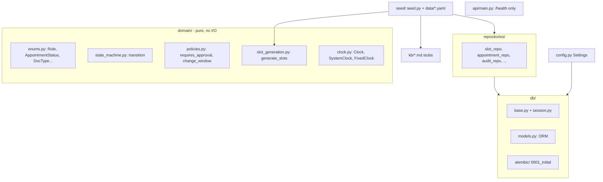

# Phase 0 — Plan (Foundations & Domain Modeling)

## Goals
1. A reproducible, linted, typed, tested Python project skeleton.
2. A correct, constraint-backed domain model with migrations.
3. Deterministic seed data + fictional KB stubs.
4. A written safety policy that every later phase implements and evaluates against.

## Architecture (Phase 0 slice)



## Ordered steps
1. **Tooling bootstrap** — install uv, `git init`, `.gitignore`, `pyproject.toml`, `.python-version`, AI-deps compatibility dry-run.
2. **Quality tooling** — ruff, mypy, pytest config, pre-commit, Makefile, `scripts/dev.ps1`.
3. **Config & infra** — `Settings`, `.env.example`, structured logging setup, `/health` FastAPI app, Dockerfile, `docker-compose.yml`, GitHub Actions CI.
4. **Domain (pure)** — enums, clock, state machine, policies, slot generation + unit tests.
5. **Persistence** — SQLAlchemy models, session, Alembic initial migration (partial unique index + audit triggers), repositories + DB tests.
6. **Seed & KB** — YAML seed data, seed script (idempotent), KB markdown stubs with front-matter, seed tests.
7. **Safety policy** — `docs/safety_policy.md`.
8. **Close-out** — export `requirements.txt` / `requirements-dev.txt`, clean-venv install check, full test + lint + mypy run, RETRO, tick docs, commit `phase-0: foundations, domain model, seed data, safety policy`.

## Dependencies between steps
1 → 2 → 3 → 4 → 5 → 6; 7 independent (can be done any time); 8 last.

## Exit criteria / Definition of Done
- [ ] `uv sync` succeeds; `python -m venv .venv-check && .venv-check/Scripts/pip install -r requirements.txt -r requirements-dev.txt` succeeds from scratch.
- [ ] `ruff check .`, `ruff format --check .`, `mypy src` all clean.
- [ ] `pytest` green; coverage of `domain/` ≥ 90%.
- [ ] `alembic upgrade head` on an empty SQLite DB creates the full schema; `alembic downgrade base` works.
- [ ] `python -m netracare.seed` populates DB; running it twice changes nothing (idempotent).
- [ ] DB-level test proves two active holds on one slot are rejected.
- [ ] DB-level test proves audit log rows cannot be updated/deleted.
- [ ] `uvicorn netracare.api.main:app` → `GET /health` returns `{"status":"ok"}`.
- [ ] `docs/safety_policy.md` covers allowed/forbidden content, red-flag list, escalation script, disclaimers.
- [ ] Docker files present (local run verification deferred — Docker not installed; noted in RETRO).
- [ ] RETRO.md written; global task.md updated; commit made.

## Demo script (Phase 0)
```powershell
.\scripts\dev.ps1 install      # uv sync
.\scripts\dev.ps1 migrate      # alembic upgrade head
.\scripts\dev.ps1 seed         # load doctors, schedules, slots, patients, KB metadata
.\scripts\dev.ps1 check        # ruff + mypy + pytest
.\scripts\dev.ps1 api          # then open http://localhost:8000/health
python -m netracare.seed --summary   # prints counts: 5 doctors, N slots, 30 patients, ...
```
