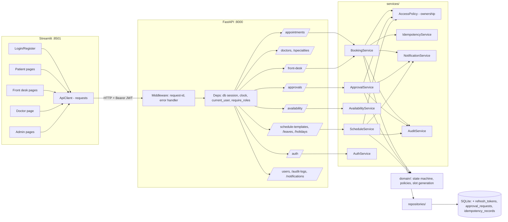
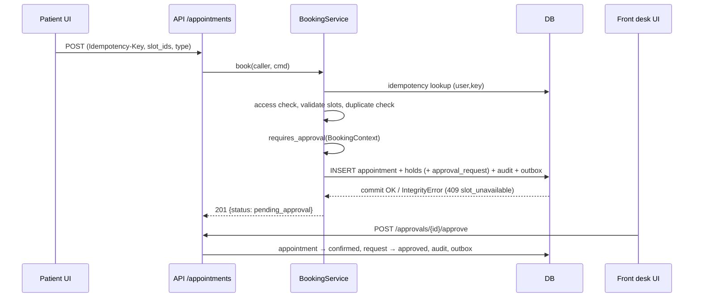

# Phase 1 — Plan (Clinic Website)

## Goals
1. A secure, fully tested REST API covering auth, directory, scheduling, availability, appointments, approvals, front-desk ops, admin and audit.
2. Booking that is provably race-safe and idempotent.
3. Four role-based Streamlit dashboards that call the API only.
4. An approval queue that the Phase 4 agent will reuse for HITL.

## Architecture (Phase 1 slice)



## Booking sequence (with approval)



## Ordered steps
1. **Foundations:** deps (pyjwt, email-validator, streamlit, requests); error model + request-id middleware; app factory with DB/clock dependencies; startup secret guard.
2. **Migration 0002:** `refresh_tokens`, `approval_requests`, `idempotency_records`.
3. **Auth:** tokens, AuthService, `/auth/*`, `current_user`, `require_roles`, login throttle; tests.
4. **Access policy + directory:** AccessPolicy, `/doctors`, `/specialties`, `/patients` (scoped); tests.
5. **Scheduling admin:** templates, leaves (conflict reporting), holidays, slot regeneration; tests.
6. **Availability:** grouped open slots, consecutive-slot logic for 30-min types; tests.
7. **Booking core:** book / cancel / reschedule with policies, idempotency, duplicates, notifications, audit; unit + API tests; **race test**.
8. **Approvals:** queue, approve/reject/withdraw, optimistic concurrency; tests.
9. **Front desk + doctor ops:** today queue, walk-ins, check-in, no-show, complete, guardian link; doctor schedule; tests.
10. **Admin users + audit + notifications endpoints**; tests.
11. **Permission matrix test** over every route × role.
12. **Streamlit UI:** ApiClient, auth pages, the role pages, AppTest smoke tests; Docker Compose `ui` service.
12b. **Opik + evals + MLOps foundation:** PII-safe tracing on booking and approval services; eval harness, datasets `booking_policy` and `safety_redflags_v0`; baseline and CI `evals-offline` gate; optional Opik upload on `main`.
13. **Close-out:** requirements export + clean install, ruff/mypy/pytest, manual demo, RETRO, docs ticked, commit + push, CI green.

## Exit criteria / Definition of Done
- [x] Every endpoint has API tests, including its permission boundaries (matrix test covers all routes × 4 roles + anonymous).
- [x] Race test: N=10 concurrent bookings of one slot → exactly 1 × 201 and 9 × 409; zero 500s; one active hold in the DB.
- [x] Idempotency: a replayed request returns the identical body + `Idempotent-Replayed: true`; a key reused with a different body → 422.
- [x] Every write action produces an audit row (asserted in tests via a helper).
- [x] 24h boundary, leave conflict, duplicate booking, and double approval are covered.
- [x] Refresh rotation + reuse detection tested; a deactivated user is locked out.
- [x] Startup refuses default secrets outside dev.
- [x] Streamlit: every page renders in AppTest for its role; login → role-specific navigation.
- [x] Opik: tracing is a no-op without a key; the exported-payload test proves no PII; with a key, a booking produces a trace in the `netracare` project.
- [x] Evals: `python -m netracare.evals run booking_policy --fail-under` passes at 100%; the CI `evals-offline` job is green and fails on a deliberately broken baseline (verified once locally).
- [x] ruff, mypy strict and pytest are green; coverage ≥ 90% overall, ≥ 95% for `services/`.
- [x] `requirements.txt` updated, clean install passes; CI green on GitHub.
- [x] RETRO written; global + phase docs ticked; commit `phase-1: …` pushed.

## Demo script (Phase 1)
```powershell
.\scripts\dev.ps1 reseed     # fresh DB + demo data
.\scripts\dev.ps1 api        # terminal 1 -> http://localhost:8000/docs
.\scripts\dev.ps1 ui         # terminal 2 -> http://localhost:8501
```
1. Register as a new patient → book a routine slot with Dr. Nair → confirmed instantly; the outbox shows an SMS.
2. Book a **surgery consult** with Dr. Rao as a new patient → `pending_approval`.
3. Log in as `frontdesk1@netracare.example` → Approvals → approve → the patient sees confirmed.
4. As the patient, try to cancel an appointment that starts in under 24h → "cancellation requested" → front desk rejects → it stays confirmed.
5. Admin adds a leave for Dr. Shetty covering a booked slot → the response lists the affected appointment, and a `leave_conflict` notification is queued.
6. Front desk registers a walk-in, checks them in; Dr. Nair marks the visit complete.
7. Admin → Audit log shows every step with actor and request ID.
8. `.\scripts\dev.ps1 evals` → booking-policy experiment report. With `OPIK_API_KEY` set, the booking traces and the experiment appear in Opik Cloud.
