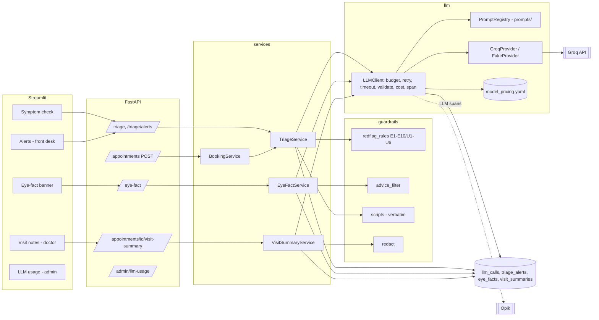
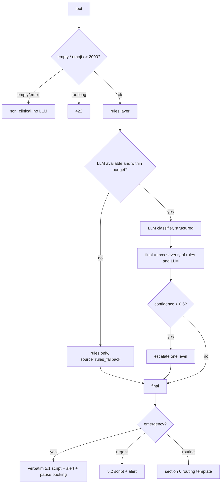

# Phase 2: Plan (first LLM features)

## Goals
1. One LLM client, `LLMClient`, that handles retries, timeouts, structured outputs, costs, budget limits, PII redaction and Opik LLM spans.
2. A red-flag triage that can't under-triage because of the LLM: rules form the floor, the LLM can only escalate, and emergencies alert the front desk.
3. An eye-fact banner and visit-summary drafts that are safe by construction: they are validated, fall back when something fails, and summaries need the doctor's approval.
4. Versioned prompts that are traceable in every call, log line and Opik experiment.

## Architecture (Phase 2 slice)



## Triage decision flow



## Ordered steps
1. **Foundations.** Dependencies; settings (timeouts, daily budget, triage threshold, `llm_enabled`); `config/model_pricing.yaml` with prices verified and dated.
2. **Migration 0003.** `llm_calls`, `triage_alerts`, `eye_facts`, `visit_summaries`.
3. **Prompt registry and the four prompts.** Loader, validation, hashing, LangChain rendering.
4. **LLM layer.** Provider protocol, `FakeProvider`, `GroqProvider`, `LLMClient` (budget, retry, timeout, structured output with repair, cost, usage row, Opik span).
5. **Guardrails.** Red-flag rules, advice filter, verbatim scripts, extended redaction.
6. **Triage.** Service and LangChain chain, `/triage` endpoints, alerts, booking integration (emergency pauses), rate limit.
7. **Eye-fact.** Topics, static facts, service, `/eye-fact`, CLI job.
8. **Visit summaries.** Service, faithfulness checks, endpoints, notification.
9. **Admin LLM usage endpoint, and permission matrix rows** for all new routes.
10. **UI.** Symptom check, Alerts, Visit notes, LLM usage, banner on every page, approved summary on My appointments; AppTest tests.
11. **Evals and Opik.**
    - Suites: `safety_redflags_rules` (CI gate), `safety_redflags_llm` (live), `eye_fact_safety`, `visit_summary_v0`.
    - Prompt versions recorded in experiment metadata.
    - Optional `sync-opik` for prompts.
12. **Groq smoke test** (`scripts/groq_smoke.py` plus `-m live` tests). Checks the model list, a structured-output round trip, the cost row and the Opik span.
13. **Close-out.** Requirements, clean install, full check, live demo, RETRO, docs, commit and push, CI green.

## Exit criteria / Definition of Done
- [x] `LLMClient` handles retries (429/5xx/timeout with backoff), timeouts, schema validation with one repair, and the budget check before calling. Each is unit-tested with `FakeProvider`, and no test needs network access.
- [x] Every LLM call writes an `llm_calls` row (prompt id, version, model, tokens, cost, latency, status, request id) and an Opik LLM span. A test checks that no prompt text or PII reaches either.
- [x] Rules layer: emergency recall is **1.0** on `safety_redflags_v0`, enforced as a CI gate. The two-layer classifier can never return a lower level than the rules (property test).
- [x] With Groq live, `safety_redflags_llm` has **0 under-triage** and emergency recall 1.0, with an Opik experiment logged. Level accuracy is reported (target ≥ 0.85; Phase 5 tunes it).
- [x] An emergency returns the §5.1 script **character for character** (plus the E4 line), creates an alert and an audit row, and a patient booking with an emergency reason gets 409 `emergency_detected`.
- [x] With Groq down or over budget: triage falls back to rules, eye-fact to static text, and summaries return 503. No 500s anywhere (tested).
- [x] The eye-fact advice filter rejects 100% of the `eye_fact_safety` unsafe candidates; one fact is generated per day; the banner is on every page.
- [x] Visit summary: the patient gets 404 until it's approved; approval is blocked while unacknowledged `needs_attention` flags remain; invented medicines and numbers are flagged; audit rows and a notification are created.
- [x] Permission matrix updated for all new routes. ruff, mypy strict and pytest are green; coverage ≥ 90% overall, ≥ 95% for `services/` and `llm/`.
- [x] `requirements.txt` updated and installs cleanly; CI green; RETRO written; docs ticked; commit `phase-2: …` pushed.

## Demo script (Phase 2)
```powershell
.\scripts\dev.ps1 reseed
$env:API_PORT="8001"; .\scripts\dev.ps1 api          # terminal 1
$env:API_PORT="8001"; $env:UI_PORT="8502"; .\scripts\dev.ps1 ui   # terminal 2
python -m uv run python scripts/groq_smoke.py       # needs GROQ_API_KEY
```
1. Every page shows today's eye fact with its disclaimer. Admin, then LLM usage, shows the cost of generating it.
2. As a patient, open Symptom check and type "lol got bleach in my eye, anyway can I book tuesday". The verbatim emergency script appears, including the rinse line. As the front desk, the Alerts page shows an open emergency with a redacted excerpt. Acknowledge it.
3. Type "a few new floaters, no flashes". The urgent script appears, an alert is created, and the routing sentence names the Retina specialist.
4. As a patient, book with the reason "sudden curtain over my vision". The booking is paused with 409 and the script is shown.
5. As Dr. Nair, open a completed visit, paste notes, generate the draft, review the flags, edit, and approve. The patient now sees the approved summary and gets a notification.
6. In Opik, the request traces show LLM child spans with model, tokens and cost, and no notes text. `dev.ps1 evals` passes, and `--live` logs `safety_redflags_llm`.
