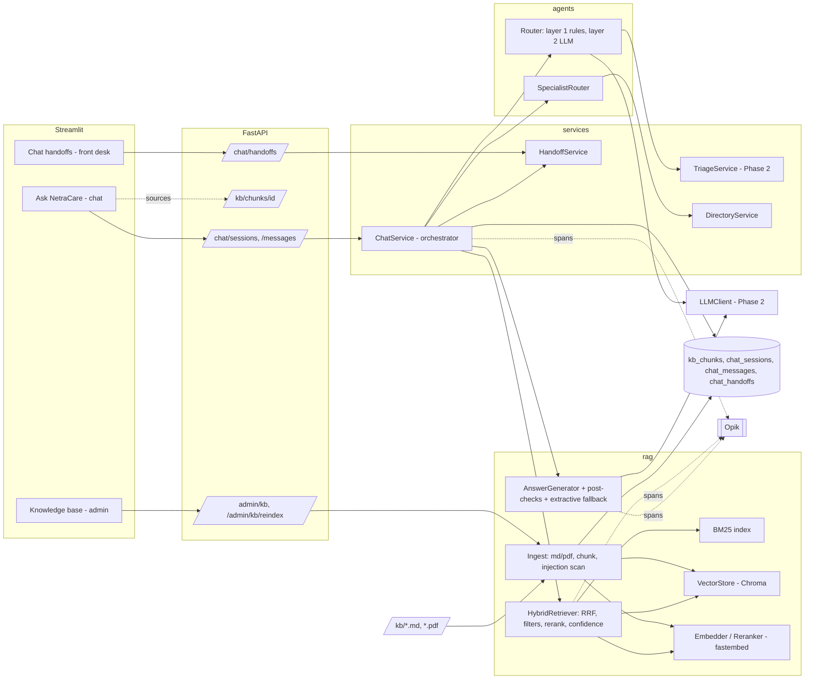
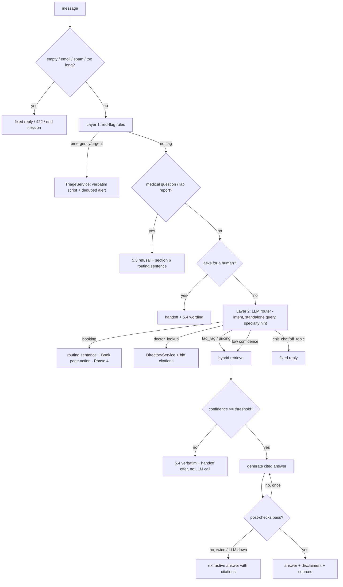

# Phase 3: Plan (patient chat with RAG)

## Goals
1. A **knowledge-base ingestion pipeline** (markdown + PDF) with heading-aware chunks, rich metadata, a `kb_chunks` table, BM25 and a Chroma vector index, and a fingerprint that detects a stale index.
2. **Hybrid retrieval** (BM25 + bge-small, RRF, metadata filters, optional rerank, tuned `k`) in which a superseded document can never be cited.
3. **Cited answers** whose citations, numbers and wording are checked by code, with an honest "I don't know" + handoff below a calibrated confidence threshold and an extractive fallback when the LLM is unavailable.
4. A **two-layer intent router** (deterministic safety first, then the LLM) with non-diagnostic specialist routing, one clarifying question for ambiguity, and booking handed off to Phase 4.
5. A patient **chat UI** (logged-in and anonymous), **front-desk handoffs**, an **admin KB page**, and offline CI eval gates for retrieval and safety routing.

## Architecture (Phase 3 slice)



## Chat turn flow



## Ordered steps
1. **Foundations.**
   - Dependencies: chromadb, rank-bm25, fastembed, pypdf.
   - Settings: retrieval k values, RRF k, threshold, rerank flag, model cache dir, chat limits and budget.
   - `models/` cache and a `dev.ps1 models` pre-download command.
   - Fastembed smoke test of both models on this machine.
2. **Migration 0004.** `kb_chunks`, `kb_index_state`, `chat_sessions`, `chat_messages`, `chat_handoffs`; `triage_alerts` gains a dedup key.
3. **Ingestion.** Loaders (md, pdf + sidecar), heading-aware chunker, metadata, injection scan, DB upsert, fingerprint, CLI, and `reseed` runs it.
4. **Indexes.** `Embedder`/`Reranker` protocols (fastembed + hashing fake), `VectorStore` (Chroma + in-memory), BM25 index with the typo map.
5. **Hybrid retriever.** Normalisation, doctor fuzzy match, filters, RRF, rerank, confidence, `RetrievalResult` with per-stage ranks; Opik retrieve span.
6. **Retrieval eval and tuning.** `rag_retrieval_v0` dataset, metrics, baseline; sweep k and rerank; calibrate the threshold; record the choices.
7. **Answer generation.** `chat_answer@v1` prompt, schema, post-checks, repair, extractive fallback, disclaimers.
8. **Router.** Layer 1 rules (+ lab-report, human-request, injection and spam detectors), `intent_router@v1`, keyword fallback; `router_rules` / `router_llm` datasets.
9. **Specialist routing.** `config/specialty_routing.yaml`, `SpecialistRouter` with the clarification state, DirectoryService doctor lookup.
10. **ChatService and handoffs.** Orchestration, sessions/ownership, limits and budget, alert dedup, handoff summaries; Opik turn trace.
11. **API.** Chat, KB chunk, handoff and admin KB endpoints; rate limits; permission matrix rows.
12. **UI.** Ask NetraCare (logged-in and anonymous), Chat handoffs, Knowledge base admin; AppTest tests.
13. **Live evals and smoke test.** `rag_answer_live`, `router_llm`; Opik experiments; the `groq_smoke` chat round trip.
14. **Close-out.** Requirements, clean install, CI model cache, full check, live demo, RETRO, docs, commit and push, CI green.

## Exit criteria / Definition of Done
- [x] `python -m netracare.rag.ingest` builds `kb_chunks` + BM25 + Chroma from `kb/` (md and a PDF fixture). Re-running it with no changes is a no-op (fingerprint), and changing a document re-indexes only that document. A poisoned fixture document is refused and reported.
- [x] **Citations resolve:** every citation in every response maps to an existing `kb_chunks` row via `GET /kb/chunks/{id}`, and the text shown is the text the model saw (tested).
- [x] **Latest effective date wins:** `superseded_leak = 0` on `rag_retrieval`, and "How much is LASIK?" cites the 2026 list with its date and never ₹45,000 (live).
- [x] `rag_retrieval` (offline CI gate): **recall@5 ≥ 0.90**, MRR reported, out-of-KB refusal ≥ 0.85, with the k, rerank and threshold choices recorded in the Decisions Log from the sweep.
- [x] **Low confidence → handoff:** out-of-KB questions get the §5.4 script verbatim with no answer LLM call (asserted on `FakeProvider.requests`).
- [x] `router_rules` (offline CI gate): **emergency recall 1.0** (a hidden emergency overrides FAQ and booking), and medical, lab-report and human-request cases are 100% correct.
- [x] Answer post-checks: an invented price, an invalid `[n]`, missing citations or advice wording each trigger a repair and then the extractive fallback (unit-tested).
- [x] Specialist routing uses §6 templates only; a child mention → D4; ambiguity → one clarifying question, then D5; the doctor name always comes from the DB.
- [x] LLM down or over budget: chat still answers (keyword router + extractive answers), and no 500s.
- [x] Sessions: another user's session → 404; anonymous token works only for its own session; turn, length, spam and budget limits enforced; repeated emergencies create one alert.
- [x] Live: `rag_answer_live` with **0 advice-filter hits, 0 numbers missing from the cited chunks**, valid citations; `router_llm` accuracy reported (target ≥ 0.85); both logged as Opik experiments with `prompt_versions`.
- [x] Opik: one trace per chat turn with guardrails, router, retrieve, generate and post-check spans, and no unredacted patient text (tested with a recording backend).
- [x] Permission matrix updated; ruff, mypy strict and pytest green; coverage ≥ 90% overall and ≥ 95% for `rag/`, `services/` and `llm/`.
- [x] `requirements.txt` updated and installs cleanly; CI green (with the model cache); RETRO written; docs ticked; commit `phase-3: …` pushed.

## Demo script (Phase 3)
```powershell
.\scripts\dev.ps1 reseed            # also runs ingestion
.\scripts\dev.ps1 models            # first time only: download the embedding and reranker models
$env:API_PORT="8001"; .\scripts\dev.ps1 api
$env:API_PORT="8001"; $env:UI_PORT="8502"; .\scripts\dev.ps1 ui
```
1. Logged out, open **Ask NetraCare** from the login page and ask "how much is lasic?" The answer is ₹52,000 with `[1]` linked to the 2026 price list, the price disclaimer showing "effective 1 April 2026", and the Sources expander showing the table chunk.
2. "And is it covered by insurance?" The follow-up is rewritten and the answer is cited from the LASIK FAQ and the insurance doc.
3. "Do you do hair transplants?" The §5.4 script appears with a "Talk to a person" offer, and no answer call shows in the Admin → AI usage page.
4. "Which eye drops should I use for dry eye?" The refusal script appears with the Cornea routing sentence (Dr. Ananya Rao).
5. Log in as a patient: "lol got bleach in my eye, anyway how much is a check-up?" The verbatim emergency script appears and the front-desk Alerts page shows one alert. Send it again; still one alert.
6. "My 6 year old's eye turns inward, can I book?" The pediatric routing sentence appears with a **Book with Dr. Arjun Menon** button.
7. "I want to talk to a person." As the front desk, **Chat handoffs** shows the redacted summary; claim it, view the conversation, close it.
8. As admin, open **Knowledge base**: documents (the 2025 list marked superseded), chunk counts, the index fingerprint, a debug search for "Dr Shetti" with BM25, vector and fused ranks, then Re-index.
9. In Opik, a chat-turn trace shows the router, retrieve and generate spans; `dev.ps1 evals` passes the new gates, and `evals-live` logs `rag_answer_live` and `router_llm`.
