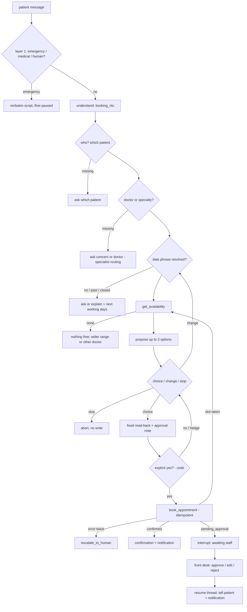

# Phase 4: Plan (booking agent, LangGraph)

## Goals
1. A **LangGraph booking agent** inside the patient chat that books, reschedules, cancels and lists appointments in natural language, through the existing services only.
2. **Write safety by construction**: every write follows a fixed read-back and an explicit "yes" decided by code; tools are idempotent and roll back on failure; an emergency pauses the flow.
3. **Human in the loop**: policy exceptions become pending requests. The front desk can **approve, edit (another time or doctor) or reject**, and the agent resumes the conversation with the decision. An overdue approval tells the patient what's happening.
4. **Durable conversations**: SQLite checkpointing, so a booking survives restarts and can be resumed later.
5. **Evals**: offline multi-turn conversation gates (no write without yes = 1.0) plus a live Groq suite in Opik.

## Architecture (Phase 4 slice)

```mermaid
flowchart LR
  subgraph UI[Streamlit]
    CH[Ask NetraCare: option buttons, read-back card]
    AP[Approvals: approve / edit / reject]
  end
  subgraph API[FastAPI]
    CS[/chat/sessions/id/messages/]
    AR[/approvals/id/approve, /approve-with-changes, /reject/]
  end
  subgraph CHAT[ChatService - Phase 3]
    L1[Layer 1 safety: emergency, medical, human]
    RT[LLM router]
  end
  subgraph AG[agents/booking]
    G[LangGraph StateGraph]
    NLU[booking_nlu@v1 - fast model]
    RD[relative_dates - code]
    CF[confirm: explicit yes - code]
    TL[tools: search_doctors, get_availability, book, cancel, reschedule, my_appointments, escalate]
    CK[(SqliteSaver - agent_checkpoints.db)]
  end
  subgraph SVC[services - Phase 1]
    BS[BookingService]
    AV[AvailabilityService]
    APS[ApprovalService + resume hook]
    DS[DirectoryService]
    HS[HandoffService]
  end
  DB[(netracare.db)]
  OPIK[[Opik]]

  CH --> CS --> L1 --> RT --> G
  G --> NLU & RD & CF & TL
  G <--> CK
  TL --> BS & AV & DS & HS
  AP --> AR --> APS
  APS -.resume thread.-> G
  BS & AV & APS --> DB
  G -.spans.-> OPIK
```

## Conversation flow (book)



## Ordered steps
1. **Foundations.** Add `langgraph`, `langgraph-checkpoint-sqlite`; settings (`agent_checkpoint_path`, proposal TTL, flow expiry, options count, overdue notice); `dev.ps1`/Makefile tasks.
2. **Relative dates** (`domain/relative_dates.py`) + a dataset and offline eval gate (incl. a DST zone).
3. **Tools** (`agents/booking/tools.py`): typed args/results calling services with the caller's identity; idempotency keys; error mapping.
4. **NLU**: `booking_nlu@v1` prompt + `BookingTurn` schema; keyword fallback; ordinal/option resolution; `is_explicit_yes`.
5. **Graph** (`agents/booking/graph.py`): state, nodes, edges, interrupts, mind changes, abort, safety pause, expiry; `BookingAgent` facade (`handle(thread_id, actor, text) -> AgentTurn`, `on_approval_decided`).
6. **Checkpointing**: `SqliteSaver` (prod) / `InMemorySaver` (tests); a restart test; a retention purge hook.
7. **HITL**: `ApprovalService.approve_with_changes`, a resume hook, notifications (approved / changed / rejected), the overdue job and on-open check.
8. **Chat integration**: `ChatService` routes `booking` intents and active flows to the agent; anonymous → sign-in prompt; parked flows; API turn payload gains `options`, `readback`, `agent_state`.
9. **API**: `POST /approvals/{id}/approve-with-changes`; approvals list shows "via chat"; permission matrix.
10. **UI**: option buttons, read-back card, pending chip on the chat page; an Edit flow on Approvals; AppTest tests.
11. **Evals**: `booking_agent_offline` (≥ 30 conversations, CI gate), `relative_dates` (CI gate), `booking_agent_live` (Groq, Opik); `groq_smoke` booking turn.
12. **Close-out**: requirements, clean install, full check, live demo, RETRO, docs, commit and push, CI green.

## Exit criteria / Definition of Done
- [x] `no_write_without_yes = 1.0` on `booking_agent_offline` and `booking_agent_live`. A property test asserts every write is preceded by a read-back and an explicit-yes turn in the same thread. "yes but…" and other hedges never write.
- [x] `booking_agent_offline` (CI gate): task success ≥ 0.95 and tool-call correctness ≥ 0.95 over ≥ 30 multi-turn conversations covering every corner case in [understanding.md §4](understanding.md).
- [x] `relative_dates` (CI gate): 100% on ≥ 40 phrases, including a DST zone; past dates, Sundays, holidays and out-of-hours requests are explained with the next working days offered.
- [x] HITL: a < 24 h reschedule, a guardian booking for a minor and a post-red-flag booking each become pending → the front desk **approves / edits (another slot) / rejects** in the UI → the agent's thread resumes and tells the patient → a notification lands in the outbox.
- [x] An overdue approval (> 4 h) shows the patient the §12 text once.
- [x] A conversation survives a restart: a new `BookingAgent` over the same `SqliteSaver` file resumes at the same step (tested). Flows idle for > 24 h expire cleanly.
- [x] Tool failure: a fault injected in `book`/`reschedule` leaves no partial writes (DB unchanged), the retry is idempotent (no double booking), and a 2nd failure creates a handoff.
- [x] A slot taken or a doctor on leave after the proposal → fresh options, no write (tested with two concurrent sessions).
- [x] Emergency mid-flow → the verbatim script and the flow paused; resume only after the patient confirms they're getting help.
- [x] Anonymous users are asked to sign in; a patient can never act on another patient's appointment (404).
- [x] Live: `booking_agent_live` task success ≥ 0.85, write safety 1.0; Opik experiment with `prompt_versions`; Groq smoke booking turn passes.
- [x] Permission matrix updated; ruff, mypy strict and pytest green; coverage ≥ 90% overall and ≥ 95% for `agents/`, `services/` and `llm/`.
- [x] `requirements.txt` updated and installs cleanly; CI green; RETRO written; docs ticked; commit `phase-4: …` pushed.

## Demo script (Phase 4)
```powershell
.\scripts\dev.ps1 reseed
$env:API_PORT="8001"; .\scripts\dev.ps1 api
$env:API_PORT="8001"; $env:UI_PORT="8502"; .\scripts\dev.ps1 ui
```
1. As a patient in **Ask NetraCare**: "I see new floaters, can you book me something next Tuesday morning?" The urgent script appears, then the routing to Dr. Vikram Shetty and 3 Tuesday-morning options as buttons. Pick one; the read-back says "needs front-desk approval (after an urgent symptom)". Tap **Yes, book it**; the reply says it's waiting for the front desk.
2. As the front desk, open **Approvals**: the request is labelled "via chat". **Edit**: pick a later slot and approve. Back in the chat, the patient sees "Your appointment was confirmed for … (changed by the front desk)", and **Messages** shows the notification.
3. As the patient: "move my appointment with Dr. Rao to the day after tomorrow". The agent picks the appointment, proposes 3 options, reads back, and on "yes but make it the afternoon" proposes afternoon options. "Yes" confirms; it's auto-confirmed if > 24 h away.
4. "Cancel my appointment tomorrow." The read-back notes it's within 24 h and needs approval; "yes" makes it pending, and the front desk rejects it with a note; the patient sees the decision.
5. Start a booking, pick an option, then restart the API (Ctrl+C, `dev.ps1 api`) and type "yes". The booking completes from the checkpoint.
6. Mid-booking: "lol bleach got in my eye, anyway book Tuesday". The verbatim emergency script appears and the flow pauses.
7. As a guardian: "book an eye check for my son". The agent asks which child, routes to Dr. Arjun Menon, and the read-back notes guardian approval.
8. In Opik, the chat-turn trace shows the `agent.*` spans (nodes, tool calls with ids only), and `evals-live` logs `booking_agent_live`.
