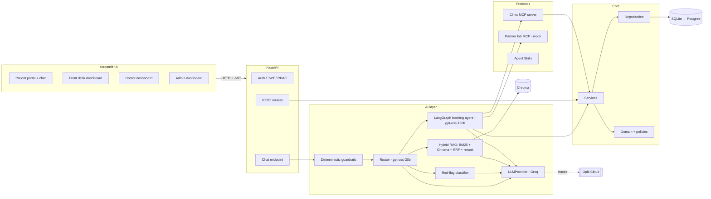

# NetraCare — Global Plan

## Goal
Deliver a portfolio-grade, safety-first AI front desk & care-coordination system for a fictional 5-doctor eye clinic, built in 8 phases (0 → 7), each gated by approved planning docs, passing tests, a clean `requirements.txt` install, a RETRO, and a `phase-N:` commit.

## System architecture

## Phases, milestones & exit criteria

| Phase | Name | Milestone | Exit criteria (all phases also require: docs ticked, `requirements.txt` installs cleanly, tests green, RETRO.md, `phase-N:` commit) |
|-------|------|-----------|------|
| 0 | Foundations & domain modeling | Repo scaffold, tooling, domain model, migrations, seed data, safety policy | `uv sync` + `pip install -r requirements.txt` clean; `alembic upgrade head` creates schema; seed script loads 5 doctors / schedules / leaves / holidays / ~30 patients / staff; state-machine + slot-generation + seed tests pass; ruff + mypy clean; `docs/safety_policy.md` complete |
| 1 | Clinic website | FastAPI auth/RBAC/CRUD/booking + 4 Streamlit role dashboards | Every endpoint has API tests incl. permission boundaries; concurrent-booking test proves no double-booking; idempotency keys honored; audit log written for every write |
| 2 | First LLM features | Eye-fact banner, visit-summary drafts, red-flag classifier, prompt registry, LLM wrapper | LLM wrapper with retries/timeouts/cost logging; structured outputs validated; emergency path alerts front desk; unit tests with mocked LLM; Groq smoke test script |
| 3 | Patient chat with RAG | KB ingestion, hybrid retrieval, cited answers, intent router, specialist routing | Retrieval tests (recall@k on a small seed set); low-confidence → handoff; citations resolve to chunks; latest effective-date wins on conflicts |
| 4 | Booking agent (LangGraph) | Agent with tools, HITL interrupts, checkpointing | Agent never writes without explicit "yes"; HITL approve/edit/reject from front-desk UI; conversation survives restart; tool failure → no partial writes |
| 5 | Evals & LLMOps (Opik) | Golden datasets, metrics, LLM-as-judge, CI gate (extends the tracing, eval harness and offline gate built in Phase 1) | Datasets at required sizes; medical-advice-leak = 0; emergency recall ≈100%; CI gate fails on regression; experiments comparable in Opik |
| 6 | MCP & Agent Skills | Clinic MCP server, lab mock MCP, MCP client, 4 skills | MCP tools scoped per role; agent uses MCP client; lab results never interpreted (eval cases); skills load & run |
| 7 | Hardening & polish | Selected improvements, security review, load test, README, deploy to **Render (native Python runtime, no Docker)** | Security checklist done; load-test report; README with diagrams; demo script; `render.yaml` blueprint with 2 Python web services (API: `uvicorn --factory netracare.api.main:app_factory`; UI: `streamlit run`), a persistent disk or Render Postgres for the DB, env vars and secrets set in the Render dashboard, and a pre-deploy `alembic upgrade head`. Live URLs smoke-tested. The Dockerfile stays optional and CI-built |

## Cross-cutting conventions
- Package layout: `src/netracare/{api,services,repositories,domain,db,llm,rag,agents,guardrails,evals,mcp,skills,ui}`.
- Every LLM call: prompt ID + version, model, tokens, cost, latency → structured log + Opik trace (from Phase 2).
- Tests: mock LLMs in unit tests; real Groq only in `evals/` and opt-in smoke tests (`-m live`).
- PII redaction before anything leaves the process (LLM prompts where feasible, Opik traces, logs).
- Commits: small per task during a phase; final `phase-N: 
` commit.

## Demo script (end state, refined per phase)
1. Patient registers, asks "How much is LASIK?" → cited answer from latest price list.
2. Patient types "lol got bleach in my eye, anyway can I book next week?" → emergency escalation overrides booking; front desk alerted.
3. Patient: "I see new floaters, book me something Tuesday" → routed to Retina (non-diagnostic explanation) → options → read-back → "yes" → booked.
4. Patient reschedules within 24h → HITL pending → front desk approves → notification in outbox.
5. Doctor writes raw notes → summary draft → approves → patient sees it.
6. Admin views audit log and Opik dashboard (cost, latency, safety metrics).
